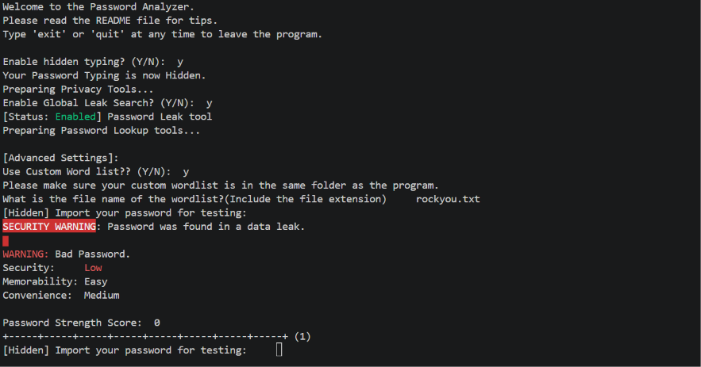
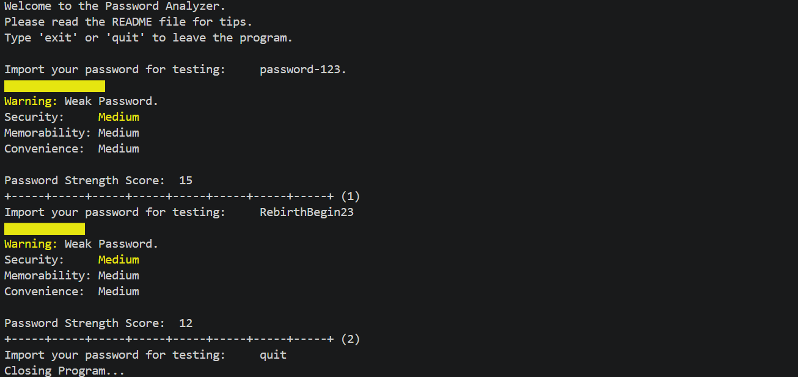

# Password Analytics Tool (V3)
A Python command-line tool that evaluates a password's strength against CISA, NIST, and OWASP recommendations.

This program uses real-world password baselines to evaluate and assign password strength scores, helping you practice strong, unique password techniques and habits.

The baselines incorporated into this program were primarily from:
* CISA.gov
* OWASP.org
* NIST.gov

## Features
1. Endless Password Analytics
2. Visual Status Reports
3. Password Strength Bar
4. Dynamic Algorithmic Scoring
5. Leaked Password Detection
6. Optional Hidden Password Typing
7. Personally Identifiable Information (PII) Scanner
8. Leaked Password Search Optimization

## What's New:
**Personally Identifiable Information (PII) Scanner:**
1. Named Entity Recognition
2. Leet-Speak Normalization 
3. Known Name Cross-Check: Integrates the NLTK names corpus to catch embedded first names (5+ characters) even when obfuscated with numbers or symbols.
**NOTE: The scanner sometimes produces false positives. No points are taken away when a PII is detected*
4. Added Additional characters to the special character counter for better scoring

**Leaked Password Search Optimization**
1. Can Choose between a quicker program when utilizing the password leak search tool **(Uses RAM)*

## Required Prerequisites
1. Need Python3 installed on your system.
2. Download the Python file.
3. In your terminal, run:
   ```bash
   python PasswordAnalyzer.py
   ```
   **NOTE:** If you change the name of the file, you must change the command to: `python [File Name].py`
4. Then follow the prompts.


## Optional Prerequisites:

### Leaked Password Detection setup

1. Download the open source `rockyou.txt` wordlist on the internet.
2. **File Location:** Move the extracted `rockyou.txt` file into the exact same folder as `PasswordAnalyzer.py`
3. **Additional Options**: You may use the tool's **Custom Wordlist** option to point to any `.txt` wordlist in your directory if you wish to use another wordlist.

### Personally Identifiable Information (PII) Scanner
You Need the NLTK and spaCy python libraries and the pre-trained Natural Language Processing (NLP) model developed by spaCy:
1. In your terminal, run:
   ```bash
   pip install spacy nltk
   python -m spacy download en_core_web_sm
   ```


## FUTURE UPDATES:
Bug Fixes and Updates of this program will come soon.


## Example Screenshots:
**Bad Password Example**  
    
**Bad Password With Hidden Typing Example**
  
**Weak Password Example**  

**Strong Password Example**  

