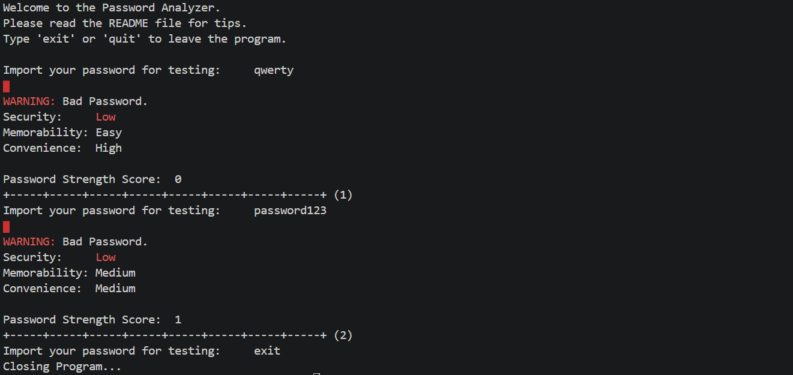
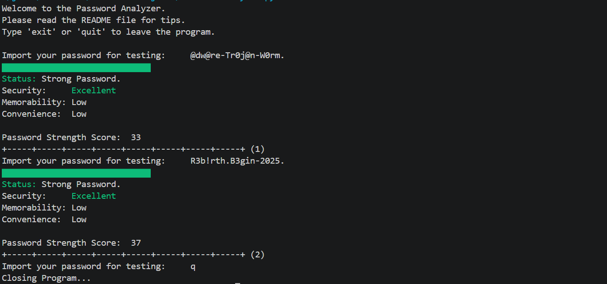

# Password Analytics Tool (V2)
A Python command-line tool that evaluates a password's strength against CISA, NIST, and OWASP recommendations.

This program uses real-world password baselines to evaluate and assign password strength scores, helping you practice strong, unique password techniques and habits.

The baselines incorporated into this program were primarily from:
* CISA.gov
* OWASP.org
* NIST.gov

## Features
1. Endless Password Analytics
2. Visual Status Reports
3. Password Strength Bar
4. Dynamic Algorithmic Scoring
5. Leaked Password Detection
6. Optional Hidden Password Typing

## Prerequisites
1. Need Python3 installed on your system.
2. Download the Python file.
3. In your terminal, run:
   ```bash
   python PasswordAnalyzer.py
   ```
   **NOTE:** If you change the name of the file, you must change the command to: `python [File Name].py`
4. Then follow the prompts.


## Optional Prerequisites: Leaked Password Detection setup

1. Download the open source `rockyou.txt` wordlist on the internet.
2. **File Location:** Move the extracted `rockyou.txt` file into the exact same folder as `PasswordAnalyzer.py`
3. **Additional Options**: You may use the tool's **Custom Wordlist** option to point to any `.txt` wordlist in your directory if you wish to use another wordlist.


## FUTURE UPDATES:
New Versions of this program will come soon:
* **Word Pattern Recognition:** New Versions of the Password Analytics tool will detect plain-text dictionary words to reduce vulnerabilities related to correlations with personal information.

## Example Screenshots:
**Bad Password Example**  
    
**Bad Password With Hidden Typing Example**
  
**Weak Password Example**  

**Strong Password Example**  

